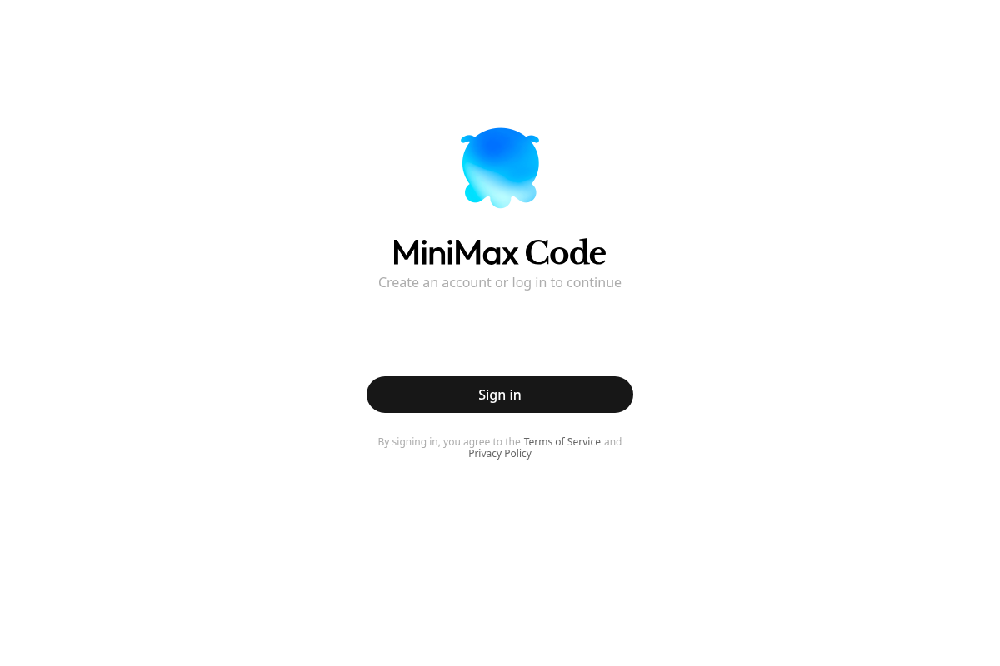

# MinimaxDeck

**Created by OSINTCabal**

Version **1.0.0**.

A MiniMax Code desktop integration for **Fedora and Debian Linux (x86-64)**. Keep the MiniMax interface, work with local projects, and manage Linux updates from the desktop or terminal. MinimaxDeck is part of my desktop app series alongside [VibeDeck](https://github.com/OSINTCabal/VibeDeck), [GrokDeck](https://github.com/OSINTCabal/GrokDeck), and [KimiDeck](https://github.com/OSINTCabal/KimiDeck).

[Install](docs/INSTALL.md) · [Development](docs/DEVELOPMENT.md) · [Verification](docs/VERIFICATION.md)



## Features

The existing MiniMax Code desktop application runs on a matching Electron Linux runtime. The Linux integration keeps the MiniMax interface and connects its update controls to the Linux installer. It also handles application-menu entries, window integration, and a separate local profile.

The integration includes per-user installation, verified downloads, update staging, rollback, and native terminal builds for your distribution. The `minimaxdeck`, `minimax-code`, and `minimaxcode` commands open the same app.

## How it works

1. **MiniMax application:** The installer obtains the official Windows package and prepares it for the matching Electron Linux runtime. Your MiniMax account provides the upstream features and usage allowance.
2. **Linux integration:** Local scripts replace supported Windows native dependencies with Linux builds, build the terminal module locally, and configure launchers, the icon, updates, and rollback.
3. **Local data:** This repository contains the integration source. Downloaded applications, runtimes, compiled dependencies, and account profiles stay outside Git. Reinstallation preserves your profile.

MinimaxDeck is unofficial and is not affiliated with MiniMax.

## Installation

Fedora and Debian use **one repository and the same installer**. Follow the [installation guide](docs/INSTALL.md) for your distribution's system packages, then run:

```bash
bash install.sh
~/.local/bin/minimaxdeck
```

Node 18 or newer is required for installation. Updates use the installed Electron runtime. The default installation is `~/.local/opt/minimax-code`, with account data under the XDG config directory in `minimax-code`. Close the app before reinstalling; the installer rebuilds the current Linux integration and preserves your profile.

To build from a downloaded installer:

```bash
bash install.sh --from-file "/path/to/MiniMax Code Setup 3.1.7.exe" --version 3.1.7
```

Downloads from the official update feed are checked against its checksum metadata. Local installers are supplied by you and do not receive independent feed verification. The installer refuses to replace unrelated launcher commands.

## Updates and rollback

```bash
minimaxdeck --update --check
minimaxdeck --update --stage
# Close MiniMax Code before rolling back.
minimaxdeck --update --rollback
```

A complete staged version becomes active on the next launch. The previous version is retained for rollback. The launcher checks for updates in the background at most once every six hours. Set `MINIMAX_NO_AUTO_UPDATE=1` to disable background staging. Systemd timer templates are included but are not enabled by the installer.

## Uninstall

```bash
~/.local/opt/minimax-code/uninstall.sh
# Explicitly delete the local MiniMax Code profile too:
~/.local/opt/minimax-code/uninstall.sh --purge
```

Ordinary uninstall preserves the account profile. Purge removes it, including saved sign-in data. Other MiniMax installations' profiles are left alone.

## Development

```bash
node --test tests/*.test.cjs
for f in install.sh minimax-code.sh uninstall.sh updater/*.sh; do sh -n "$f" || exit; done
```

Use a disposable installation with `MINIMAX_CODE_ROOT`, `XDG_BIN_HOME`, `XDG_DATA_HOME`, and `MINIMAX_UPDATE_CACHE` for testing. Never test purge or rollback against a working profile. See the [development guide](docs/DEVELOPMENT.md).

## Notes

- Baseline: MiniMax Code 3.1.7 with Electron 42.8.0. Upstream changes can require integration updates.
- Initial installation needs internet access, a compiler, and several gigabytes of temporary disk space.
- Windows session-transfer components are excluded. Do not assume every Windows-specific feature is available on Linux.
- Browser sign-in remains an upstream MiniMax feature. Changing a user-agent does not guarantee that every identity provider will accept embedded sign-in.
- ASAR symlinks are rejected. New native dependencies and terminal-module versions need a reviewed compatibility update.
- The MIT license covers the integration code in this repository. Upstream application and dependency licenses still apply. Their bundled notices are retained during installation.

## Screenshots

Fresh installations on both distributions:

| Fedora 44 | Debian 12 |
| --- | --- |
|  |  |

These captures show the real MiniMax sign-in screen in disposable profiles. They contain no account data. See [verification](docs/VERIFICATION.md) for what was tested.

## Coming soon

More desktop features, packaging improvements, and broader Linux desktop testing are planned.
